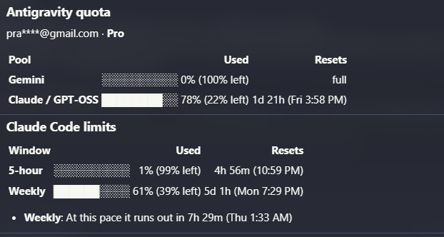
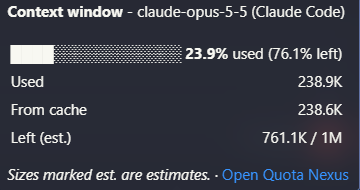
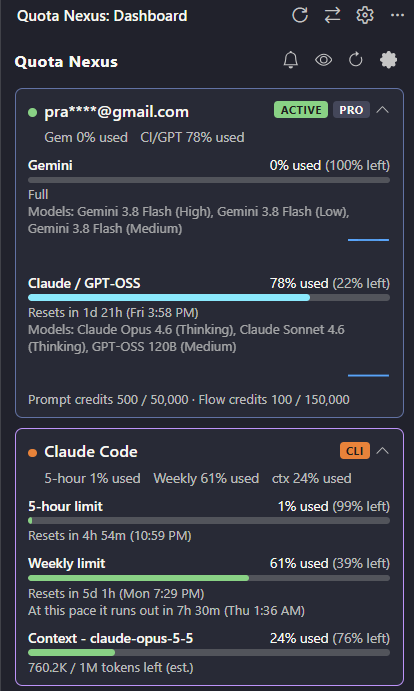
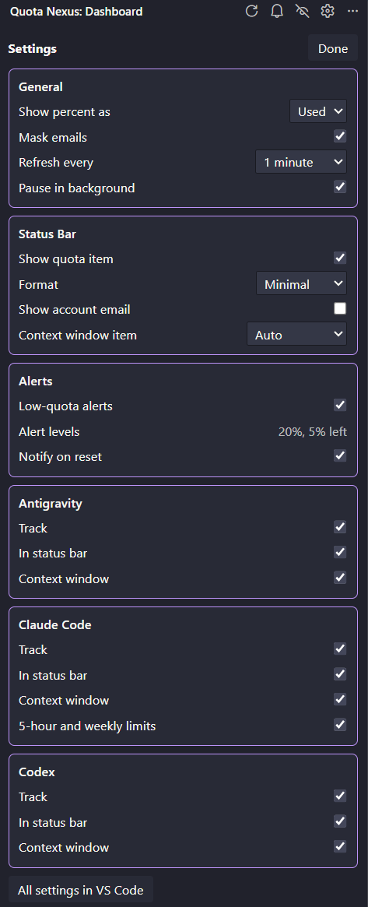

# Quota Nexus

See how much AI quota you have left, when it resets and when you will run out, for **Antigravity**, **Claude Code** and **Codex**, right in your status bar.

> **Unofficial.** Not affiliated with, endorsed by or sponsored by Google, Anthropic or OpenAI. "Antigravity", "Gemini", "Claude" and "Codex" are trademarks of their owners.

**Hover details:** quota pools and limits, with used and left side by side, reset times and a run-out forecast.

**Context window:** how full each active session is.

**Dashboard**

**Settings in the dashboard:** click the gear for every switch, grouped by tool.

## Install

- **VS Code:** search "Quota Nexus" in the Extensions view, or run `code --install-extension quota-nexus.quota-nexus`.
- **Antigravity IDE, Cursor, Windsurf, VSCodium:** search "Quota Nexus" in the Extensions view (served from [Open VSX](https://open-vsx.org/extension/quota-nexus/quota-nexus)).

## Features

- **One status bar for three tools.** For example: `Antigravity: Gemini 0% · Claude / GPT-OSS 78% used | Claude Code: 3% · wk 76% used | Codex: 34% used`. It turns yellow, then red, as anything runs low.
- **Used or left, your choice.** Numbers show what is used by default, like the Claude Code and Codex screens. Set **Percent Mode** to `left` to count down instead. The hover and dashboard always show both, for example `57% (43% left)`. Short formats mark each number with ↑ (used) or ↓ (left).
- **Run-out forecast.** Nexus tracks your burn rate and tells you "At this pace it runs out in 2h 10m (3:40 PM)" or "lasts until the reset".
- **24-hour history.** A small chart per quota shows how fast you used it.
- **Smart alerts.** You get a notification at 20% and 5% left (you can change the levels), and another when a quota resets. When one Antigravity pool is low, it suggests a pool that still has room. Snooze alerts for an hour with one click.
- **Context window meter.** Shows how full the active Antigravity conversation, Claude Code session or Codex session is, with a `/compact` tip when it gets full.
- **Real quota pools.** Antigravity models that share a quota are grouped, and each pool lists its models.
- **Several Antigravity accounts.** Nexus remembers each account you sign in with, shows its last-seen quota and when it resets, and lets you label it (Work, Personal).
- **Diagnostics.** If something isn't detected, **Quota Nexus: Show Diagnostics** tells you why.
- **Privacy first.** Emails are masked by default and hidden from the status bar.
- **Follows your theme.** Works in light, dark and high-contrast themes.

## How it works

Quota Nexus reads data that is already on your machine:

| Tool | Data | Source | Network |
|---|---|---|---|
| Antigravity | Quota, plan, credits, context window | The local Antigravity server (`agy` or the IDE) on `127.0.0.1` | None |
| Claude Code | Context window | Session logs in `~/.claude/projects` | None |
| Claude Code | 5-hour and weekly limits (opt-in, off by default) | Your existing token in `~/.claude/.credentials.json` | `api.anthropic.com` only |
| Codex | Rate limits, plan, context window | Session logs in `~/.codex/sessions` | None |

To talk to the local Antigravity server, Quota Nexus reads that server's port and local session token from its process command line. This is the same way the IDE connects. Nothing leaves your machine.

Codex writes its rate limits into its logs each time it runs. Nexus shows them "as of" that moment. Once a window's reset time has passed, it shows "likely reset".

## Privacy and security

- Quota Nexus **stores no sign-in tokens** and never reads, decrypts, writes or deletes another app's credentials.
- No telemetry, analytics or third-party servers.
- Stored data (in VS Code's extension storage only):
  - each Antigravity account's email, display name, label, plan and last-seen quota;
  - 7 days of quota percentages for the charts;
  - the last Claude Code limits (percentages and reset times only), so other windows and reloads reuse them instead of asking again.
- Claude Code limits are off by default. When you turn them on, the token is read-only and is never refreshed or rewritten.
- Diagnostics never log tokens or full email addresses.

## Switching Antigravity accounts

Quota Nexus switches through Antigravity's own sign-in, so it never touches your sign-in tokens. Run **Quota Nexus: Switch Antigravity Account**, pick an account and click **Sign Out and Switch**:

1. Quota Nexus opens agy, signs it out and starts Google sign-in for you.
2. In the browser, pick the account and click **Continue**.
3. Copy the code Google shows, then click **Paste Code** in VS Code.

Nexus detects the new account within seconds and remembers it, so the dashboard shows each account's last quota. Antigravity IDE users can use the IDE's account menu instead.

## Commands

- `Quota Nexus: Refresh Quota`
- `Quota Nexus: Switch Antigravity Account`
- `Quota Nexus: Sign In With Another Antigravity Account`
- `Quota Nexus: Snooze or Resume Alerts`
- `Quota Nexus: Toggle Email Masking`
- `Quota Nexus: Toggle Used / Left`
- `Quota Nexus: Show Diagnostics`
- `Quota Nexus: Open Settings`

## Settings

The quickest way: click the **gear** in the Quota Nexus dashboard title bar. Every switch is there in the same groups, and a tool's switches grey out while that tool is off.

The same settings are in VS Code (**Settings > Extensions > Quota Nexus**). All names start with `quotaNexus.`.

**General**

| Setting | Default | What it does |
|---|---|---|
| `display.percentMode` | `used` | Show percent `used` or percent `left` |
| `privacy.maskEmails` | `true` | Mask emails |
| `refresh.activeInterval` | 1 minute | How often to refresh (30 seconds to 5 minutes) |
| `refresh.pauseWhenUnfocused` | `true` | Pause the timed refresh while VS Code is in the background |

**Status Bar**

| Setting | Default | What it does |
|---|---|---|
| `statusBar.show` | `true` | Show the quota item |
| `statusBar.format` | `descriptive` | `descriptive`, `compact` or `minimal` |
| `statusBar.showEmail` | `false` | Show the Antigravity account |
| `contextWindow.display` | `auto` | Which context windows to show: `auto`, `antigravity`, `claudeCode`, `codex`, `all` or `off` |

**Alerts**

| Setting | Default | What it does |
|---|---|---|
| `alerts.enabled` | `true` | Low-quota notifications for all three tools |
| `alerts.thresholds` | `[20, 5]` | Percent-left levels for alerts and status bar colours |
| `alerts.notifyOnReset` | `true` | Notify when a quota is full again |

**Antigravity, Claude Code and Codex** (each tool has the same switches)

| Setting | Default | What it does |
|---|---|---|
| `<tool>.enable` | `true` | Track this tool. Off: Antigravity is not searched for, logs are not read |
| `<tool>.showInStatusBar` | `true` | Include its quota or limits in the status bar (still in the hover and dashboard) |
| `<tool>.showContextWindow` | `true` | Include its context window |
| `claudeCode.fetchUsageLimits` | `false` | Opt-in Claude Code 5-hour and weekly limits |

`<tool>` is `antigravity`, `claudeCode` or `codex`. Settings from older versions (`showInNavBar`, `contextWindow.showAntigravity`) move to the new names automatically.

## Requirements

- VS Code 1.80 or later.
- At least one of: Antigravity (`agy` CLI or IDE), Claude Code, or Codex on the same machine.
- Windows, macOS or Linux. On macOS and Linux, `lsof` is used as a fallback to find the Antigravity server port.

## Known limits

- Antigravity and Claude Code context window sizes are estimates. Codex reports its own.
- Inactive Antigravity accounts are not polled. Their numbers are the last values seen while they were active.
- Codex limits update only when Codex runs. After 7 days without Codex activity they leave the status bar (the dashboard still shows them, marked Idle).
- Claude Code limits use an undocumented endpoint that may change. If Anthropic rate-limits it, Nexus waits longer between tries (up to 30 minutes) and keeps showing the last values.
- Forecasts need about 15 minutes of history before they appear.

## License

MIT
